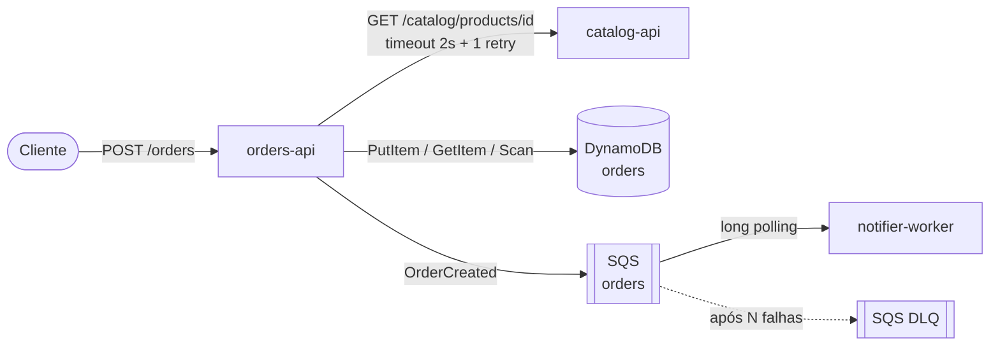

# shop-aws

Sistema "Shop" em 3 microsserviços Go, num monorepo. É um projeto de estudo de containers e AWS
(ECS, DynamoDB, SQS).

## Arquitetura



| Serviço                                         | Tipo          | Responsabilidade |
|-------------------------------------------------|---------------|------------------|
| [catalog-api](services/catalog-api/README.md)         | HTTP (`/catalog`) | Produtos, carregados em memória a partir de um seed JSON. |
| [orders-api](services/orders-api/README.md)           | HTTP (`/orders`)  | Cria pedidos: valida, consulta o preço no catalog, salva (memória ou DynamoDB) e publica `OrderCreated` no SQS. |
| [notifier-worker](services/notifier-worker/README.md) | Worker (sem HTTP) | Consome a fila e "envia" a notificação (por enquanto, um log). Idempotente por `eventId` e com falhas simuladas via `FAIL_RATE`. |

### Fluxo de um pedido

1. O cliente faz `POST /orders` com `productId`, `quantity` e `customerEmail`.
2. O orders-api consulta o catalog-api. Se o produto não existe ou está inativo, responde 422.
   Se o catalog está fora do ar, responde 503.
3. O pedido é salvo com status `CREATED` e o evento `OrderCreated` é publicado no SQS.
   Se a publicação falhar, o pedido continua salvo com `eventPublished=false`.
4. O notifier-worker recebe o evento, loga `notification sent` e apaga a mensagem. Se o
   processamento falhar, a mensagem volta para a fila e, depois de algumas tentativas, vai para a DLQ.

O header `X-Request-Id` (correlation ID) acompanha o pedido do começo ao fim: requisição,
chamada ao catalog, mensagem na fila e logs do worker. Para rastrear um pedido, basta filtrar
os logs pelo `requestId`.

## Convenções comuns

- **Configuração:** só por variáveis de ambiente, sem `.env` obrigatório. As variáveis de
  cada serviço estão no README dele. Todos aceitam `SERVICE_NAME`, `LOG_LEVEL` (default `info`)
  e `APP_VERSION` (default `dev`).
- **Logs:** JSON no stdout, uma linha por evento, com `timestamp`, `level`, `service`,
  `version`, `message` e `requestId`.
- **Graceful shutdown:** no SIGTERM, os serviços param de aceitar trabalho novo, terminam o que
  está em andamento e saem em no máximo 18s.
- **AWS:** SDK oficial (aws-sdk-go-v2), com a região vinda de `AWS_REGION` e credenciais da
  cadeia padrão do SDK. `AWS_ENDPOINT_URL` aponta para um emulador local (LocalStack etc.).

## Estrutura

```
shop-aws/
└── services/
    ├── catalog-api/       # módulo Go independente
    ├── orders-api/        # módulo Go independente
    └── notifier-worker/   # módulo Go independente
```

Cada serviço tem seu próprio `go.mod`, então pode ser compilado e empacotado de forma
independente, usando a pasta do serviço como contexto de build. Os pacotes `logging` (e
`httpx`, nos serviços HTTP) são duplicados de propósito: assim nenhum serviço depende de outro.

## Requisitos

- Go 1.24+

## Rodando localmente (sem AWS)

Em três terminais:

```sh
# 1. catalog
cd services/catalog-api && PORT=8081 go run .

# 2. orders (memória, sem fila)
cd services/orders-api && PORT=8082 CATALOG_URL=http://localhost:8081 go run .

# 3. testar
curl -s -X POST localhost:8082/orders \
  -H 'X-Request-Id: teste-1' \
  -d '{"productId":"p-001","quantity":2,"customerEmail":"ana@example.com"}'
curl -s localhost:8082/orders
```

Para usar DynamoDB e SQS (na AWS ou num emulador) e rodar o notifier-worker, veja os READMEs
do [orders-api](services/orders-api/README.md#rodando-localmente) e do
[notifier-worker](services/notifier-worker/README.md#rodando-localmente).

> **LocalStack:** as versões recentes da imagem `localstack/localstack` exigem a variável
> `LOCALSTACK_AUTH_TOKEN`. Uma alternativa sem conta é usar o ElasticMQ (SQS) e o DynamoDB
> Local, apontando cada serviço com `AWS_ENDPOINT_URL_SQS` e `AWS_ENDPOINT_URL_DYNAMODB`.

## Build

```sh
cd services/<serviço>
go build -o bin/<serviço> .
```

## Infraestrutura

Dockerfiles, compose e Terraform ainda não fazem parte do repositório. Antes de provisionar,
a infra precisa de:

- uma tabela DynamoDB com partition key `id` (String);
- uma fila SQS com redrive policy apontando para uma DLQ;
- as permissões IAM listadas no README de cada serviço.
